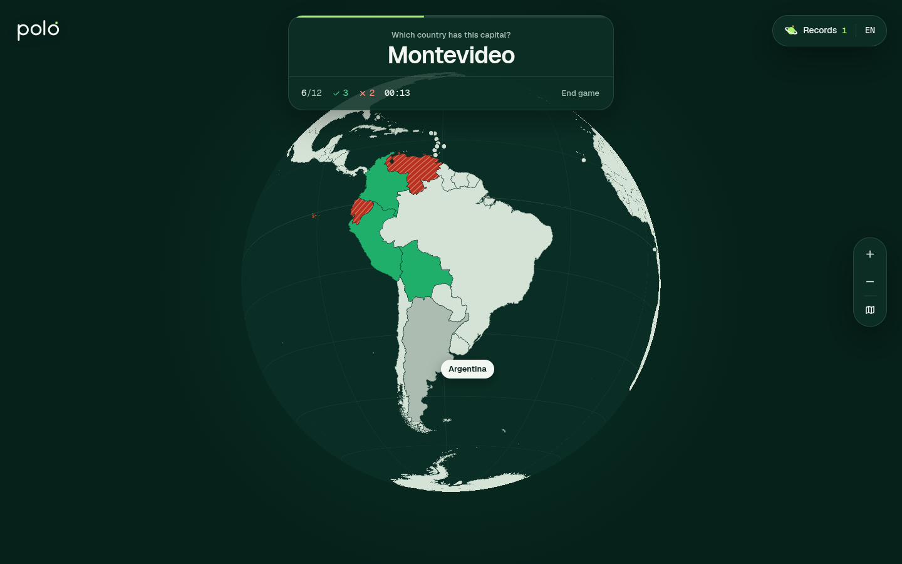
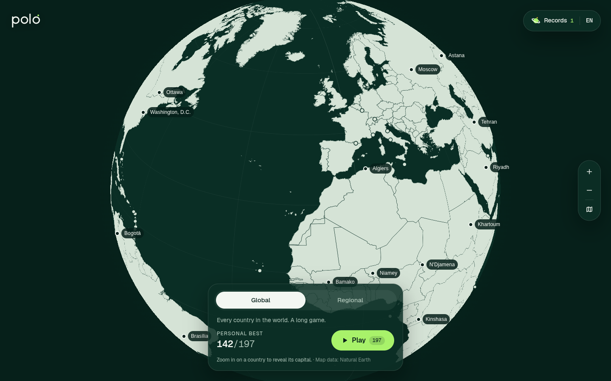

<p align="center">
  <picture>
    <source media="(prefers-color-scheme: dark)" srcset="public/brand/polo-wordmark.svg" />
    
  </picture>
</p>

<p align="center"><strong>A capital is drawn. You find its country on the map.</strong></p>



Polo is a geography game played on a single interactive world map. It runs entirely in the browser: no backend, no database, no account, no API key.

- **Live demo:** _add the Vercel URL here_
- **Stack:** React 19 · TypeScript · Vite · MapLibre GL JS · Natural Earth

## Contents

- [The problem](#the-problem)
- [Features](#features)
- [Tech stack and why](#tech-stack-and-why)
- [Architecture](#architecture)
- [Performance decisions](#performance-decisions)
- [Product decisions](#product-decisions)
- [Design and identity](#design-and-identity)
- [Running locally](#running-locally)
- [Deploying](#deploying)
- [What I would build next](#what-i-would-build-next)
- [Author](#author)

## The problem

Most capital quizzes are multiple choice or a text box. They test whether you can recall a word, not whether you know where a place is. You can score well and still be unable to point at Burkina Faso.

Polo asks the spatial question instead. It shows a capital and you have to click the country on a real map. When you miss, the game takes you to the right country before moving on, so a mistake teaches you something.

## Features

**Lobby.** The first screen is the map itself. You can drag, scroll, pinch and use the zoom buttons, as you would in Google Maps. Capitals appear as you get close to a country, and the mode selector and Play button stay on screen.



**Two game modes.**

| Mode | Pool | Length |
| --- | --- | --- |
| Global | All 197 countries | Long |
| Regional | One continent: Africa (54), Asia (49), Europe (45), North America (23), Oceania (14) or South America (12) | Short |

**A round.**

1. A capital is drawn at random and shown at the top of the screen.
2. You click the country it belongs to. Hovering a territory shows only the country name.
3. **Correct:** the country turns green and stays green.
4. **Wrong:** the right country pulses in amber with its name, the camera moves to it if it is off screen, and then it settles to hatched red for the rest of the game.

Every capital in the pool is asked once. A miss does not end the game.

**Personal bests.** The best score is stored per mode and per continent. A perfect run earns a planet medal and records the time it took; a faster perfect run replaces it.

**Also included.** Globe and flat projections, English and Brazilian Portuguese (picked from the browser language), touch support, and reduced-motion support.

## Tech stack and why

| Choice | Why |
| --- | --- |
| **React 19** over Angular | The map is an imperative WebGL canvas that owns its own render loop. The framework only has to manage a thin shell around it: a few panels and one state machine. React does that with less ceremony and a smaller bundle. Angular's strengths (dependency injection, forms, routing, structure for large teams) would go unused here. |
| **TypeScript**, strict | The game state is a discriminated union, so "playing" data cannot be read in the lobby by mistake. The compiler enforces the rules of the game. |
| **Vite** | Produces a plain static bundle, which is all Vercel needs. |
| **MapLibre GL JS** | See below. |
| **Natural Earth** | Public domain, maintained by cartographers, and it ships borders, sovereignty and capitals in one consistent dataset. |
| **CSS Modules + custom properties** | Scoped styles with zero runtime cost. A design system of eight colours does not need a CSS framework. |
| **Vitest** | Unit tests for the pure logic: the game reducer, the record rules and the cookie codec. |
| **Vercel** | Static hosting with a CDN and Brotli. No server code is needed. |

### Choosing the map library

The brief was "navigation that feels like Google Maps". That means inertial panning, continuous zoom rather than steps, and pinch gestures.

| | MapLibre GL JS | Leaflet | D3 |
| --- | --- | --- | --- |
| Rendering | WebGL, vector | DOM / SVG / raster | SVG or Canvas |
| Zoom | Continuous, GPU-interpolated | Stepped by default | Hand-built |
| Pan inertia, pinch | Built in | Built in | Hand-built |
| Recolouring 250 polygons per answer | One paint property update | 250 SVG nodes to restyle | Manual redraw |
| Globe projection | Built in | No | Yes, without the gestures |

MapLibre won because it gives Google-Maps-grade gestures for free and repaints countries on the GPU. D3 would have meant rebuilding navigation from scratch, and Leaflet's SVG layer gets heavy with detailed borders.

One point worth calling out: Polo uses **no map tiles**. The style contains only local GeoJSON sources, so there is no tile server, no third-party request and no key.

## Architecture

```
src/
├── config/app.ts        Single source of truth for the product name and metadata
├── data/                Typed access to the generated country data
├── game/                Pure game logic, no React and no DOM
│   ├── session.ts       Reducer: lobby → playing → finished
│   ├── records.ts       Personal-best rules and cookie codec
│   └── modes.ts         Mode ids and country pools
├── map/                 Everything that touches MapLibre
│   ├── MapController.ts Imperative facade: marks, hover, signals, camera
│   ├── CapitalLabels.ts Zoom- and viewport-aware capital labels
│   ├── layers.ts        Style, layers and paint expressions
│   └── MapView.tsx      The only React component that knows the map exists
├── hooks/               useGame, useRecords, useElapsed
├── components/          Presentational UI
├── i18n/                Typed message catalogues (en, pt-BR)
└── styles/              Design tokens and shared primitives
scripts/
├── build-data.mjs       Natural Earth → simplified GeoJSON + country metadata
└── build-brand.mjs      SVG → PNG for the social image and app icons
```

Three boundaries keep the code easy to reason about.

**The game is a pure reducer.** `sessionReducer(session, action)` has no side effects and takes the current time as an argument. That makes every rule testable in a line: input is locked while feedback is showing, a miss is recorded against the target rather than the clicked country, and ending early keeps the partial score.

**React never touches MapLibre directly.** `MapController` exposes a small vocabulary (`setMarks`, `signal`, `focus`, `setCapitals`). React passes state down as props and the controller translates it into paint properties and filters. Pointer movement goes the other way without a re-render: the tooltip is positioned by writing to a ref, and React only re-renders when the hovered country changes.

**The product name lives in one constant.** `APP.name` in `src/config/app.ts` feeds the header, and a small Vite plugin injects it into the page title, the Open Graph and Twitter tags, and the generated web manifest. Renaming the product is a one-line change. The drawn logo is the one exception, since its letters are geometry.

## Performance decisions

**Capitals render by zoom and by viewport.** There are 197 capitals and showing them all would be unreadable. `CapitalLabels` runs three checks on every camera move, throttled to one pass per animation frame:

1. **Zoom.** Each country has a threshold computed at build time from its on-screen size, so Brasília appears early and Luxembourg only when you are close. Countries are pre-sorted by threshold, so the loop stops at the first one that fails.
2. **Viewport.** Capitals outside the screen, or on the far side of the globe, are skipped.
3. **Collision.** A greedy pass places larger countries first and drops any label that would overlap one already placed.

Only the survivors exist in the DOM, usually between 5 and 40 elements. Labels are HTML rather than a WebGL symbol layer, which avoids hosting font glyph files and lets them use the same typeface as the rest of the interface.

**The geometry is prepared at build time.** `scripts/build-data.mjs` takes Natural Earth's 1:10m countries (13 MB), keeps two properties per feature, simplifies the shapes and rounds coordinates to about 100 m. The result is 1.3 MB, or about 450 kB compressed. The output is committed, so a deploy needs no network access to third parties.

**Answering a question costs one GPU update.** Country colours come from a single `match` expression on the fill layer. A correct answer rebuilds that expression and MapLibre repaints; no geometry is re-uploaded and React does not render the map.

**The map engine loads in its own chunk.** MapLibre is about 300 kB compressed, most of the JavaScript. It is loaded with `React.lazy`, so the shell (about 90 kB) paints first. Parsing and tiling the GeoJSON happens in MapLibre's web worker, off the main thread.

**Tiny countries stay clickable.** Vatican City is smaller than a pixel at most zoom levels. The 34 smallest states also get a dot marker with a generous hit area, coloured by the same expression as the polygons.

## Product decisions

**No backend.** Nothing in the product needs one. The data is static, the game is single-player and the only state worth keeping is a handful of numbers. Leaving the server out means no cold starts, no cost, no data to protect and no way for the game to be "down" short of the CDN itself.

**One cookie, one purpose.** Personal bests are stored in a single first-party cookie, `polo_pb`, and nothing else is stored anywhere. Even the language choice is re-detected on each visit instead of being saved. The cookie is `SameSite=Lax`, `Secure` over HTTPS, lasts a year, and holds a compact JSON map of about 100 bytes. On read it is validated field by field: unknown modes, impossible scores and a perfect time without a perfect score are all discarded, so a hand-edited cookie cannot break the interface.

**Bests are counted in correct answers, perfection is timed.** The personal best is the highest number of capitals answered correctly, kept separately for Global and for each continent. Time only matters once you have a perfect run, where it becomes the tiebreaker to beat. This keeps the early goal simple (get more right) and gives experts something to chase.

**A miss teaches.** On a wrong answer the right country is shown for about two seconds, with its name, before it turns red. The red then stays for the rest of the game as a map of what to study. After a game ends the capital labels come back, so you can inspect what you missed.

**Assumptions made where the brief was open.**

- **Which countries.** 197: the 193 UN member states, the two observer states (Vatican City and Palestine), plus Kosovo and Taiwan, a common convention in geography quizzes.
- **Territories.** A dependency counts as its sovereign state. Clicking Greenland answers Denmark, and Greenland turns green with it. Sovereignty follows Natural Earth's de facto view; Western Sahara and Antarctica belong to no playable country.
- **Countries with more than one capital.** One is used: Pretoria for South Africa, Sucre for Bolivia, Sri Jayawardenepura Kotte for Sri Lanka. Palestine uses Ramallah so that no two countries share an answer.
- **Capitals are hidden during a game**, since showing them would give the answer away.
- **Six continents** for Regional mode, with North and South America separate.

## Design and identity

The full rationale is in [docs/BRAND.md](docs/BRAND.md). In short:

**Concept.** *Polo* is Portuguese for "pole", the fixed point a map is oriented by. The identity uses the globe, its tilted axis and the pole. One number runs through all of it: 23.5°, the Earth's axial tilt, applied to the logo, the favicon and the medal.

**Logo.** The wordmark is drawn from circles and straight stems rather than set in a font. Its final `o` is a tilted globe with a dot at the north pole.

**Colour.** A palette of dark pine greens, pale sage land and one bright accent named after the aurora. I read the research before choosing it, and the evidence is more modest than design blogs claim: Elliot's 2015 review finds colour effects are context-dependent, and much of the "green is calming" evidence comes from nature scenes rather than the colour. So green is used here for what does hold up: its learned association with land and with "correct", and the low glare of dark, desaturated tones over a 197-round game.

**Accessibility of green and red.** The two game states never rely on colour alone. Missed countries carry a diagonal hatch, the hues are a bluish green against an orange-leaning red, the states differ in lightness, and every status in the interface has an icon and a text label.

**Type.** Geist for the interface and Geist Mono for scores and timers, both self-hosted.

## Running locally

Requires Node.js 20 or newer.

```bash
npm install
npm run dev        # http://localhost:5173
```

| Script | What it does |
| --- | --- |
| `npm run dev` | Development server |
| `npm run build` | Type-check, then build to `dist/` |
| `npm run preview` | Serve the production build |
| `npm test` | Unit tests |
| `npm run lint` | ESLint |
| `npm run data` | Rebuild the map data from Natural Earth |
| `npm run brand` | Rebuild the PNG brand assets from SVG |

`npm run data` and `npm run brand` are only needed if you change the country list or the logo. Their output is committed.

## Deploying

The project is a static site and deploys to Vercel with no configuration beyond what is in the repository.

1. Push the repository to GitHub.
2. Import it in Vercel. The Vite preset is detected: build command `npm run build`, output directory `dist`.
3. Deploy.

`vercel.json` sets long-lived cache headers for the hashed assets and for the map data. The absolute URL for the social preview image is taken from Vercel's production domain at build time; set a `SITE_URL` environment variable to use a custom domain.

Any other static host works too: run `npm run build` and serve `dist/`.

## What I would build next

- **Keyboard play.** A searchable country list as an alternative to clicking, so the game is fully playable without a pointer.
- **More question types.** Flags, country shapes, or the reverse (given a country, name the capital).
- **Spaced repetition.** A practice mode that brings back the countries you miss most often.
- **Shareable results.** A generated image of the final map, with no server involved.
- **Offline play.** A service worker; the app already has no runtime dependencies on the network.
- **End-to-end tests.** Playwright runs of a full game, alongside the existing unit tests.

## Data and credits

Map data from [Natural Earth](https://www.naturalearthdata.com/), in the public domain. Rendering by [MapLibre GL JS](https://maplibre.org/). Typeface: [Geist](https://vercel.com/font).

## Author

**_Your name_**

- GitHub: [_@your-handle_](https://github.com/your-handle)
- LinkedIn: [_your-profile_](https://www.linkedin.com/in/your-profile)
